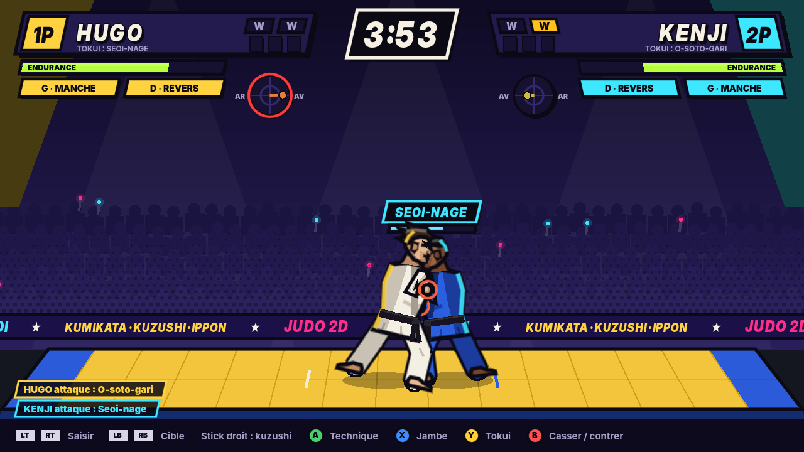

# Judo 2D

Jeu de combat de judo en 2D pour PC, jouable à la manette. Pas de barre de vie :
on gagne par le **kumikata**, le **kuzushi** et le **timing**. Direction artistique inspirée de 2XKO.



## Lancer

1. Installer [Godot 4.4](https://godotengine.org/download).
2. Ouvrir le dossier dans Godot (ou `godot --path .`), puis F5.
3. Brancher une ou deux manettes. Sans manette, le combat se joue IA contre IA (démo).
   Flèches + Entrée / Échap permettent de naviguer dans les menus au clavier.

## Commandes (manette, notation Xbox)

| Commande | Debout | Au sol |
| --- | --- | --- |
| Stick gauche | Déplacement | Gigoter (dessous) |
| Stick droit | Kuzushi (traction / poussée) | — |
| LT / RT | Main gauche / droite : saisir et serrer | — |
| LB / RB | Changer la cible de la main (manche, revers, col haut, ceinture) | — |
| A | Technique selon la direction du kuzushi | Contrôler |
| X | Technique de jambe | Clé de bras |
| Y | Tokui-waza | Étranglement |
| B | Casser la prise, bloquer, contrer | Se dégager |
| Tap court sur A/X/Y | Feinte | — |
| Start | Pause | Pause |

## Ce qui est jouable

- Combat complet en 4 minutes réelles : kumikata à deux mains, jauge d'équilibre, endurance,
  13 techniques debout, 5 contres, 5 enchaînements, feintes, blocages, shidos, golden score.
- Ne-waza : osaekomi (10 s waza-ari, 20 s ippon, toketa), clés et étranglements en bras de fer.
- Builds : set de techniques à 15 points, garde droitier / gaucher (ai-yotsu / kenka-yotsu),
  style de kumikata en pierre-feuille-ciseaux, profil physique à rendements décroissants.
- Modes : tournoi à 8 contre l'IA (3 niveaux), versus local à deux manettes.
- Écrans : titre, menu, personnalisation, sélection, tournoi, combat, pause, résultats, options, en ligne (maquette).

## Architecture

```
data/            valeurs de réglage (config.json), techniques, catalogue, liste de tournage
scripts/sim/     simulation déterministe (entiers, tick fixe 60/s) + IA
scripts/view/    dessin des judokas (placeholders) et bibliothèque de sprites
scripts/ui/      design system (palette, typo, panneaux inclinés)
scripts/screens/ un script par écran
tools/           banc de test, captures d'écran, outils vidéo et Blender
docs/            pipeline d'animation, guide de tournage
```

La simulation n'utilise que des entiers et aucun aléatoire : mêmes entrées, même résultat.
L'état se sauvegarde et se restaure (base du futur netcode rollback) ; c'est vérifié par checksum.

## Outils

```
# Banc de test : déterminisme + statistiques IA contre IA (paires de builds 0 Hugo, 1 Kenji, 2 Aya)
godot --headless --path . -s tools/sim_test.gd -- --matches=24 --level=2 --builds=0,1

# Régénérer toutes les captures d'écran (Linux : Xvfb sur DISPLAY=:99)
tools/capture_all.sh

# Rushes vidéo et sprites : voir docs/PIPELINE_ANIMATION.md et docs/GUIDE_TOURNAGE.md
```

## Polices

Inter et Inter Display (licence OFL 1.1, voir `fonts/LICENSE-Inter.txt`).
